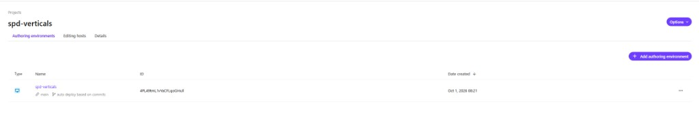
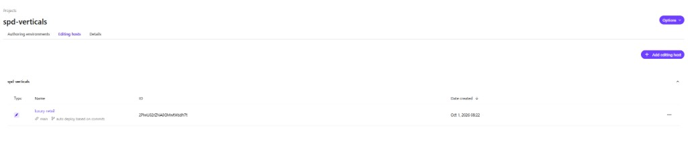
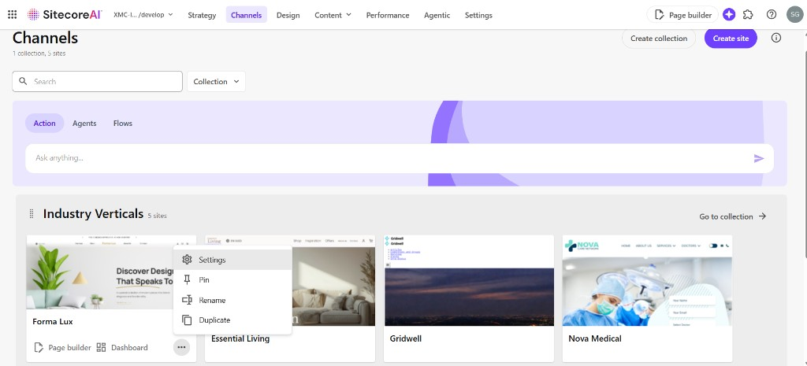
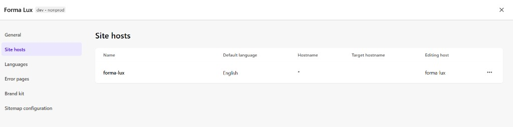

# Deployment Guide - Industry Verticals

Follow these steps to set up your environment for custom demos using the Industry Verticals template.

---

## 1. GitHub Setup

First, you need a personal copy of the codebase to allow for customizations while keeping in sync with the main repository.

**Fork the Repository:** Create a fork of this codebase.

---

## 2. Deployment

Verify the beta features toggle in the Deploy Portal settings. If it is enabled, beta features are active; if not, enable it to continue with this guide. The scope and impact of this setting are described directly in the toggle.

### 2.1. Project Creation

1. Navigate to **Projects** and select **Create New Project**
2. Choose **"Use your own code"**
3. Give authoring environment name
4. Point your GitHub account, the repository you forked and the branch you want to use (`main`, if you haven't changed anything)

The **spd-verticals** project on SE8 has one authoring environment, `spd-verticals` (`main`):



**Crucial:** Add the DAM-related environment variables on the authoring environment. Copy the connection string, search page URL, and credentials from your team's secret store into the Deploy portal only. Do not paste them into this repository, into docs, or into source files.

| Variable name | What to enter |
|--------------|----------------|
| `Sitecore_ConnectionStrings_DAM_dot_ContentHub` | Content Hub connection string from the team secret store (`ClientId`, `ClientSecret`, `UserName`, `Password`, `URI`) |
| `Sitecore_ConnectionStrings_DAM_dot_SearchPage` | Content Hub approved-assets URL from the team secret store |
| `Sitecore_ConnectionStrings_DAM_dot_ExternalRedirectKey` | `Sitecore` |
| `SITECORE_AppSettings_damEnabled__define` | `yes` |

### 2.2. Setup Editing Hosts

Give it the relevant name from the table below exactly as listed, point it to the same GitHub repository and branch, and add the environment variables according to the table.

> **Note:** `nextjsstarter` is used for the Forma Lux site.

> **Note:** You can only create 1 editing host through this wizard. You can go into your editing hosts screen later on to create additional editing hosts.

#### Forma Lux

| Editing Host Name | Environment Variable Name | Environment Variable Value |
|-------------------|---------------------------|---------------------------|
| `nextjsstarter` | `NEXT_PUBLIC_SEARCH_ENV` | `prod` |
| | `NEXT_PUBLIC_SEARCH_CUSTOMER_KEY` | _from CEC portal_ |
| | `NEXT_PUBLIC_SEARCH_API_KEY` | _from CEC portal_ |
| | `NEXT_PUBLIC_SEARCH_SOURCE` | _from CEC portal (Forma Lux source)_ |

#### SkyWings

| Editing Host Name | Environment Variable Name | Environment Variable Value |
|-------------------|---------------------------|---------------------------|
| `travel` | `NEXT_PUBLIC_SEARCH_ENV` | `prod` |
| | `NEXT_PUBLIC_SEARCH_CUSTOMER_KEY` | _from CEC portal_ |
| | `NEXT_PUBLIC_SEARCH_API_KEY` | _from CEC portal_ |
| | `NEXT_PUBLIC_SKYWINGS_SEARCH_SOURCE` | _from CEC portal (SkyWings source)_ |

SkyWings does **not** use `NEXT_PUBLIC_SEARCH_SOURCE`. Use `NEXT_PUBLIC_SKYWINGS_SEARCH_SOURCE`. In this repo the editing host key is `travel`.

#### GridWell

| Editing Host Name | Environment Variable Name | Environment Variable Value |
|-------------------|---------------------------|---------------------------|
| `energy` | `NEXT_PUBLIC_SEARCH_ENV` | `prod` |
| | `NEXT_PUBLIC_SEARCH_CUSTOMER_KEY` | _from CEC portal_ |
| | `NEXT_PUBLIC_SEARCH_API_KEY` | _from CEC portal_ |
| | `NEXT_PUBLIC_GRIDWELL_SEARCH_SOURCE` | _from CEC portal (GridWell source)_ |

#### Nova Medical

| Editing Host Name | Environment Variable Name | Environment Variable Value |
|-------------------|---------------------------|---------------------------|
| `healthcare` | _(No search variables required)_ | |

#### Essential Living

| Editing Host Name | Environment Variable Name | Environment Variable Value |
|-------------------|---------------------------|---------------------------|
| `luxury-retail` | _(No search variables required)_ | |

Search customer keys, API keys, and source ids are not written in this guide. Copy them from the CEC / search configuration into the editing-host variables in Deploy. SkyWings uses `NEXT_PUBLIC_SKYWINGS_SEARCH_SOURCE`, not `NEXT_PUBLIC_SEARCH_SOURCE`. GridWell uses `NEXT_PUBLIC_GRIDWELL_SEARCH_SOURCE`.

#### Check that every editing host exists

`xmcloud.build.json` defines five rendering hosts. Each key must exist as an editing host on the project, with the same spelling and case.

| Site | Sitecore site name | Editing host name | App folder |
|------|--------------------|-------------------|------------|
| FormaLux | `forma-lux` | `nextjsstarter` | `industry-verticals/retail` |
| Essential Living | `essential-living` | `luxury-retail` | `industry-verticals/luxury-retail` |
| Skywings | `skywings` | `travel` | `industry-verticals/travel` |
| Gridwell | `gridwell` | `energy` | `industry-verticals/energy` |
| Nova Medical | `nova-medical` | `healthcare` | `industry-verticals/healthcare` |

On **1 Oct 2026**, project **spd-verticals** has all five editing hosts: `nextjsstarter`, `luxury-retail`, `travel`, `energy`, and `healthcare`. Search variables are set on `nextjsstarter`, `travel`, and `energy`. DAM connection variables are set on the authoring environment. The screenshot below was taken before those hosts were added and shows only `luxury-retail`.



Create the missing hosts with **Add editing host** (same repository and branch as the authoring environment). The wizard creates only one host; add the rest from this tab.

After `dotnet sitecore cloud login`, check from the repo root. The script prints host names only. It does not print variable values.

```powershell
dotnet sitecore cloud project list --json
node scripts/check-editing-hosts.mjs --project-id <project-id>
```

`present` on every row means the Deploy name matches `xmcloud.build.json`. `MISSING` means Pages cannot use that rendering host until you add it.

Next, you can review and deploy. When this is completed, you can now access your websites in SitecoreAI.

### 2.3. Assign Editing Hosts

Once the editing hosts have been deployed, you may need to assign the correct editing host to each site.

1. Navigate to **Channels** in SitecoreAI and open the site menu (**Settings**)



2. Open **Site hosts**
3. Set **Editing host** to the name from the table above



The name is case-sensitive. `travel` and `Travel` are different hosts.

FormaLux must use `nextjsstarter`, not `forma-lux`. The screenshot above shows `forma-lux` in the Editing host column. Change it to `nextjsstarter` after that editing host exists, or Pages will not load the retail rendering host.

---

## 3. Vercel Deployment

Follow the [Vercel Deployment Guide](./VERCEL-DEPLOYMENT.md) to deploy the site to Vercel.

---

## 4. Localization Support

### 4.1. Supported Languages

By default, the Forma Lux site supports the following locales, while other sites support English only:

- `en` (English)
- `fr-FR` (French)
- `es-ES` (Spanish)

### 4.2. Add Additional Languages (Optional)

1. Navigate to **Channels** → Click the three dots on the specific site → **Settings** → **Languages**
2. Add the required languages and provide translations for the newly added languages
3. After adding the new languages, update the `locales` array in the `next.config.js` file to include the new language codes

### 4.3. Other

To display languages in the language switcher on the Forma Lux site, go to `src/constants/localeOptions.ts` and update the `localeOptions` array with `code`, `label`, `currency` and `currencySymbol` for specific locale.

---

## 5. Create New Source in CEC Portal (Optional)

You can either use the Search Source which we have already configured, or you can create your own source.

- **To use the already configured Search Source:** Use the environment variables mentioned in the tables above
- **To create a new source:** Follow the documentation below to create a new source in CEC portal and link to your application. Make sure to use the search-related environment variables from the newly created source in your deployment configurations:
  - [CEC Source Creation Guide](https://sitecore.atlassian.net/wiki/x/ZwAengE)

---

## 6. Content Hub URL Migrator (Optional)

Say goodbye to manual updates: Content Hub URL Migrator for updating host names.

Follow these steps to perform a bulk update of Content Hub asset links within your site branch:

### Step 1: Locate the Target Item

In the Sitecore Content Editor, navigate to the specific site, folder, or page where you need to update links.

### Step 2: Launch the Migrator

Right-click on the item, then navigate to **Scripts** > **Custom Tools** > **Update Content Hub Host name**.

### Step 3: Enter Migration Details

A dialog window will appear. Enter the required information:

- **Current Hostname (Old):** The sandbox or old environment URL you wish to replace
- **New Hostname:** The destination Content Hub URL (e.g., your production host)

### Step 4: Execute the Update

Click **Run Migration**. The script will recursively scan all child items and replace the hostnames in all matching fields.

### Step 5: Review and Publish

Once the process finishes, an alert will show the total number of items updated. Perform a **Smart Publish** on the affected branch to push the new URLs to your live site.

### Step 6: Update Remote Patterns

Update remote patterns in `next.config` with your new hostname for the specific industry vertical site.

---

## Quick Reference

### Environment Variables Summary

| Site | Editing Host Name | Search Source Variable |
|------|-------------------|----------------------|
| FormaLux | `nextjsstarter` | `NEXT_PUBLIC_SEARCH_SOURCE` |
| Skywings | `travel` | `NEXT_PUBLIC_SKYWINGS_SEARCH_SOURCE` |
| Gridwell | `energy` | `NEXT_PUBLIC_GRIDWELL_SEARCH_SOURCE` |
| Nova Medical | `healthcare` | _(none)_ |
| Essential Living | `luxury-retail` | _(none)_ |

### Common Search Environment Variables

All sites with search functionality use these variables (values from the [CEC portal](https://sitecore.atlassian.net/wiki/x/ZwAengE) or your Deploy portal editing-host configuration):

```
NEXT_PUBLIC_SEARCH_ENV=prod
NEXT_PUBLIC_SEARCH_CUSTOMER_KEY=<from CEC portal>
NEXT_PUBLIC_SEARCH_API_KEY=<from CEC portal>
```

---

## 7. Check and update environment variables (Deploy CLI)

Use the Sitecore CLI to inspect or set editing-host environment variables without opening the Deploy portal. Requires [Sitecore CLI](https://doc.sitecore.com/xmc/en/developers/xm-cloud/sitecore-cli.html) and access to the XM Cloud organization.

### 7.1. Login

```bash
dotnet sitecore cloud login
```

Complete the device login in the browser when prompted.

You can also run [scripts/check-editing-hosts.mjs](../scripts/check-editing-hosts.mjs) (see [Check that every editing host exists](#check-that-every-editing-host-exists)). It compares `renderingHosts` keys to the project's editing hosts and does not print secrets.

### 7.2. Find the project and editing host

List projects:

```bash
dotnet sitecore cloud project list --json
```

List environments (authoring CM + editing hosts) for a project — use the project `id` from the previous command:

```bash
dotnet sitecore cloud environment list --project-id <project-id> --json
```

Each editing host (`type`: `eh`) has its own **environment id**. Use that id for variable commands below. In the JSON output, find the entry whose `name` matches your editing host (for example `travel`, `nextjsstarter`, or `energy`) and copy its `id` field.

> Environment and project ids are specific to your XM Cloud organization. Use `project list` and `environment list` output — do not hardcode ids from another team's project.

### 7.3. List current variables

```bash
dotnet sitecore cloud environment variable list -id <editing-host-environment-id> --json
```

Example — list variables for the **travel** editing host (substitute your host's environment id):

```bash
dotnet sitecore cloud environment variable list -id <editing-host-environment-id> --json
```

Expected variables for **Skywings** (`travel`):

| Variable |
|----------|
| `NEXT_PUBLIC_SEARCH_ENV` |
| `NEXT_PUBLIC_SEARCH_CUSTOMER_KEY` |
| `NEXT_PUBLIC_SEARCH_API_KEY` |
| `NEXT_PUBLIC_SKYWINGS_SEARCH_SOURCE` |

> Skywings uses `NEXT_PUBLIC_SKYWINGS_SEARCH_SOURCE`, not `NEXT_PUBLIC_SEARCH_SOURCE`. Variable **values** come from the [CEC portal](https://sitecore.atlassian.net/wiki/x/ZwAengE) or the editing-host tables in [§2.2](#22-setup-editing-hosts) — compare CLI output against your Deploy portal configuration.

### 7.4. Create or update a variable

```bash
dotnet sitecore cloud environment variable upsert -id <editing-host-environment-id> -n <VARIABLE_NAME> -val <value> --target EH
```

> **Important:** Include `--target EH` when updating existing editing-host variables. Omitting it can fail with `Secret type change is not allowed`.

Example — set the FormaLux search source (value from CEC portal or §2.2):

```bash
dotnet sitecore cloud environment variable upsert -id <editing-host-environment-id> -n NEXT_PUBLIC_SEARCH_SOURCE -val <source-id> --target EH
```

Example — set Skywings search source:

```bash
dotnet sitecore cloud environment variable upsert -id <editing-host-environment-id> -n NEXT_PUBLIC_SKYWINGS_SEARCH_SOURCE -val <skywings-source-id> --target EH
```

After changing variables, trigger **Build and deploy** for that editing host in the Deploy portal so the rendering host picks up the new values.

### 7.5. Bulk setup script

For multiple hosts at once, see `scripts/setup-editing-hosts.js` in the repo root (creates hosts and upserts variables interactively).

---

_Document Version: 1.1_  
_Last Updated: June 2026_
