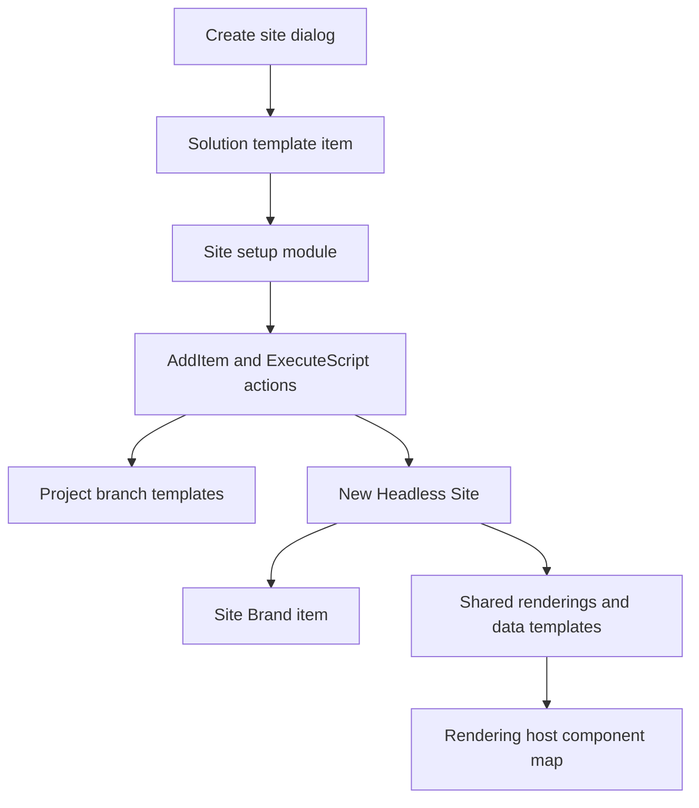

# SitecoreAI site templates

Research for a reusable site template that appears in **Create site**. Snapshot of the starter repo is `Sitecore/xmcloud-starter-js` `main`. The live content manager check was repeated on 22 Oct 2026 against the verticals environment (`xmc-sitecoresaa00ce-modernverti39a4-verticalsslaf21.sitecorecloud.io`). Read-only. Nothing was created, edited, published, or deleted for this research.

Sources are named inline: Sitecore docs (doc.sitecore.com/sai and developers.sitecore.com, via the Sitecore docs search), the starter repo on GitHub, and the authoring GraphQL API on that content manager.

## Architecture

A card in **Create site** is a **Solution template** item. Its data template is `/sitecore/templates/Foundation/JSS Experience Accelerator/Scaffolding/Solution template` (`1b2dfd3b-f2f2-4f40-a75c-f6c2490919c4`).

Creating a site does not clone that item. The wizard:

1. Creates a site collection (headless tenant) if needed. A new collection also gets `/sitecore/system/Settings/Project/[collection]`.
2. Creates a headless site under that collection.
3. Runs every module listed on the Solution template, in order. The last module is the template's own **site setup**.
4. Assigns an analytics identifier for the default language.

Foundation and Feature items are the product's Prebuilt templates. A Solution template under `/sitecore/system/Settings/Project/` is a Custom template. Favorites are a per-user flag, not a field. All sites in one collection must use the same site template.

## What makes the dialog card

Verified on the Basic Site item and on Alaris / Solterra YAML.

| Piece | Required for a card | Required for a working create | Field |
| --- | --- | --- | --- |
| Solution template item | Yes | Yes | Template `1b2dfd3b-f2f2-4f40-a75c-f6c2490919c4` |
| Name | Yes, this is the title | Yes | `82e64b52-0b8a-4a38-8c78-530c5493814e` |
| Description | Shown under the title | Optional | `9f437e68-a84d-48ae-8ce1-a3e26c0b5e64` |
| Content | JSON array shown as "included in this template" | Optional | `da855368-e5f2-4932-ae55-7f8b08a5a205` |
| Site Modules | Not shown | Yes. Must include a HeadlessSiteSetupRoot | `c262443b-653d-461d-96c8-7cfaa0ef2b2d` |
| Tenant Modules | Not shown | Yes for a new collection | `41ac536a-923a-43f9-ac87-f3993f638125` |
| __Thumbnail | Optional image | Optional | `c7c26117-dbb1-42b2-ab5e-f7223845cca3` |

There is no Prebuilt/Custom field. Location decides the tab. Docs: [Create a site](https://doc.sitecore.com/sai/en/users/sitecoreai/create-and-manage-sites/create-a-site.html), [Create a site template](https://doc.sitecore.com/sai/en/developers/sitecoreai/content-modeling-and-presentation/sitecoreai-for-developers/content-editor-items/sites/create-a-site-template.html).

The setup item uses template HeadlessSiteSetupRoot (`bed31d6f-d968-45a9-b54e-12d7f977d861`). Its children are actions:

- **AddItem** (`3aea335c-d06d-45b1-841a-cbc8d2d1ce40`). `Template` points at a branch. `Location` (`52c91c75-6698-4701-a8a2-242ace59a8d6`) points at a branch node that maps onto the new site (Home, Data, Presentation). `Name` is the item name to create.
- **ExecuteScript** (`bc9bb684-36df-4285-888b-d8b4d87b10de`). `Script` points at a PowerShell script module under `/sitecore/system/Modules/PowerShell/Script Library/`.

Editing those scripts in Content Editor needs `SITECORE_SPE_ELEVATION=Allow` and a redeploy. Pushing serialized scripts does not.

Do not put custom items inside SXA Foundation or Feature branches. SXA updates overwrite them. Use a sibling Project module. Docs: [Add and extend a template](https://doc.sitecore.com/sai/en/developers/sitecoreai/content-modeling-and-presentation/sitecoreai-for-developers/content-editor-items/site-collections/add-and-extend-a-template.html).

## Annotated inventory

### This content manager (22 Oct 2026)

Only two Solution template items were present on 21 Oct 2026, and the same two paths still resolve. No item is named Skatepark.

| Item | Path | Id | What it is |
| --- | --- | --- | --- |
| Basic | `/sitecore/system/Settings/Feature/JSS Experience Accelerator/Basic Site/Templates/Basic Site` | `5aae1eea-ea24-40bf-96f1-1f43da82c77b` | Prebuilt. Name `Basic`. Description: simple website with homepage, subpage, navigation, and footer. Content JSON: Home, About; basic SXA components; CDP Personalize and Analytics. |
| Basic Site Setup | `.../Basic Site/Basic Site Setup` | HeadlessSiteSetupRoot | Actions: Add About, Add Default Page Design, Add Footer Partial, Add Headers Partial, Add Home Data, Add Home renderings. |
| Empty | `/sitecore/system/Settings/Foundation/JSS Experience Accelerator/Scaffolding/Templates/Empty Site` | `2867d289-8951-458a-af19-ce93a67bb494` | Prebuilt. Name `Empty`. Content JSON: Home; SXA; CDP Personalize and Analytics. |
| Created site `basic` | `/sitecore/content/basic/basic` | SiteTemplate field points at Basic | Home, About, Header and Footer partials, Default page design, SXA style folders. Site grouping host name is `*`. |
| Industry sites | `/sitecore/content/industry-verticals/*` | SiteTemplate field points at Empty | Finished sites (FormaLux, Nova Medical, and the others). They are not Create-site templates. |

PowerShell library `/sitecore/system/Modules/PowerShell/Script Library/JSS SXA` contains Basic Site, Multisite, Scaffolding, and Site Metadata. There is no Skatepark script module.

Feature scaffolding on this instance lives under `/sitecore/system/Settings/Feature/JSS Experience Accelerator`, not the `Headless Experience Accelerator` path in the walkthrough. The walkthrough still describes the same items (Basic Site folder, setup, Templates child, branch folder, script library).

### Starter repo (`authoring/items/items/templates`)

Module `Project.click-click-launch`, file `authoring/items/items/templates/ccl.module.json`. `CreateUpdateAndDelete` on Project paths only.

| Include | Sitecore path |
| --- | --- |
| ccl.templates | `/sitecore/templates/Project/click-click-launch` |
| ccl.templates.branches | `/sitecore/templates/Branches/Project/click-click-launch` |
| ccl.modules | `/sitecore/system/settings/Project/click-click-launch` |
| ccl.renderings | `/sitecore/layout/Renderings/Project/click-click-launch` |
| ccl.placeholderSettings | `/sitecore/layout/Placeholder Settings/Project/click-click-launch` |
| ccl.powershell | `/sitecore/system/Modules/PowerShell/Script Library/Click Click Launch` |
| ccl.media.fd / ms / bp | `/sitecore/media library/Feature/Alaris`, `Solterra`, `SYNC` |

Under `ccl.modules/click-click-launch`:

- Solution templates: `Templates/Alaris.yml` (`dd0b78f3-6a05-4c09-991e-fb09d1b472d1`), `Templates/Solterra and Co.yml` (`6393776b-d724-49eb-8a3f-96af12825810`), `Templates/SYNC.yml`. No Skatepark.
- Site setups: `Alaris Setup` (`0ea2d04c-785e-4273-bc5f-380634764df3`), `Solterra and Co Setup`, `SYNC Setup`. Each is the last id in that template's Site Modules list.
- Alaris actions: Add Available Renderings, Add Enumerations, Add Home Page Data Folder, Add Home Renderings, Add Partial Designs, Add Products, Add Taxonomy, Add Test Drive, Data Folders, Rendering Variants, Post Setup Step.

`authoring/spe-scripts/site-2-setup.ps1` and `site-3-setup.ps1` are the script bodies those ExecuteScript actions call. `xmcloud.build.json` enables `nextjsstarter` (Skatepark app), `kit-nextjs-article-starter`, `kit-nextjs-location-starter`, `kit-nextjs-product-starter`, and `basic-nextjs`. `angularstarter` and `basic-nextjs-pages-router` are disabled. `authoringPath` is `./authoring`. The file does not list `Project.click-click-launch` under `deployItems`; the module is picked up because it sits under `authoring/items`.

### This repo

No `examples/` kits. No Solution template is serialized. Modules are site content (`Project.Retail-Content` and siblings) plus `Project.IndustryVerticals` and `Foundation.BasePage`. `deployItems.modules` is only those two. Site content is in `postActions.scsModules`. A custom template belongs in its own Project module, for example `authoring/items/site-templates/versatile/`, and must be added to deploy the same way.

Page designs in this repo use `TemplatesMapping` (`ba1f60d6-3deb-40cc-bb61-eec772279ee1`) on `Presentation/Page Designs`. Pairs are URL-encoded `{template}={design}` joined with `%26`. Settings → Templates must point at the project template folder or `$templates` lists system templates. See [docs/SITECORE-SITE-SHELL.md](../SITECORE-SITE-SHELL.md).

## Skatepark, Alaris, and Solterra

| | Skatepark / Basic (this CM) | Alaris | Solterra & Co. |
| --- | --- | --- | --- |
| Where the card comes from | Base image. Feature-layer Basic Site. Not in this repo. | Project module in the starter repo. Not deployed here. | Same module. Not deployed here. |
| Dialog name | `Basic` | `Alaris` | `Solterra & Co.` |
| Front end | `examples/kit-nextjs-skate-park`, host key `nextjsstarter` | `examples/kit-nextjs-location-finder`, host key `kit-nextjs-location-starter` | `examples/kit-nextjs-article-starter`, host key `kit-nextjs-article-starter` |
| Pages called out in Content JSON | Home, About | Home, Products, Test Drive | Home, Article Page, Landing Page |
| Extra setup | SXA Basic Site actions only | Products, taxonomy, enumerations, partials, variants, post step | Own setup id `e243bdaa-ae7a-41da-a183-cb25ec90f8c3` |
| Components in the app | column-splitter, container, content-block, image, link-list, navigation, page-content, partial-design-dynamic-placeholder, promo, rich-text, row-splitter, title, structured-data | Shared kit library below, plus location-search, product-listing, forms, zipcode-modal, image gallery | Same shared library, plus article-listing. No product-listing. |
| Theming in the app | SXA styles copied onto the site | `theme-provider`, `mode-toggle`, Tailwind | Same |
| Personalization claim | Content JSON says CDP Personalize and Analytics | Same phrase | Same phrase |

Skatepark is the brand of the `nextjsstarter` host. The Create site card on this environment is **Basic**, and the site created from it is `/sitecore/content/basic/basic`. The host name `*` on that site grouping is called out in the headless-site docs as a publish error.

## What creation copies, and what stays shared

Docs: [The site items](https://doc.sitecore.com/sai/en/developers/sitecoreai/content-modeling-and-presentation/sitecoreai-for-developers/content-editor-items/the-site-items.html), [Create a headless site](https://doc.sitecore.com/sai/en/developers/sitecoreai/content-modeling-and-presentation/sitecoreai-for-developers/content-editor-items/site-collections/create-a-headless-site-collection-and-site.html). Confirmed on `/sitecore/content/basic/basic`.

Copied onto the new site:

- Home and the pages the setup actions insert.
- Media: a virtual folder. Binaries stay in the Media Library. The site item's SiteMediaLibrary field points at the library folder.
- Data: folders only for modules the wizard selected.
- Dictionary.
- Presentation: Available Renderings, Headless Variants, Page Branches, Page Designs, Partial Designs, Placeholder Settings, Styles.
- Settings and Site Grouping.

Referenced, not copied:

- Renderings under `/sitecore/layout/Renderings`.
- Data templates and branch definitions.
- Grid and foundation modules.
- The Solution template item itself. The new site stores its id in **SiteTemplate**.

Changing the template, its branches, or its setup changes the **next** site only. Changing a shared rendering definition or a project data template changes every site that references it. Clone Site is a different operation: it copies `/sitecore/content/{collection}/{site}` and `/sitecore/media library/Project/{collection}/{site}`.

## Page types, designs, partials, placeholders

Docs: [Assign a page design](https://doc.sitecore.com/sai/en/users/sitecoreai/build-pages/building-page-templates-and-branches/assign-a-page-design-to-a-template.html), [Partial designs](https://doc.sitecore.com/sai/en/users/sitecoreai/build-pages/building-page-templates-and-branches/work-with-partial-designs.html), [Structuring pages](https://doc.sitecore.com/sai/en/developers/sitecoreai/content-modeling-and-presentation/sitecoreai-for-developers/best-practices/recommendations--structuring-pages.html).

- A page data template inherits the foundation Page template (`3f8a6a5d-7b1a-4566-8cd4-0a50f3030bd8`) and `_PerSiteStandardValues` (`44a022db-56d3-419a-b43b-e27e4d8e9c41`).
- One Page Design item per page type. `PartialDesigns` (`0966b999-0d0e-4278-acc9-9da69d461fe6`) lists partial ids. Do not put content renderings on the page design. Do not set the Page Design field on the page item. Map templates with `TemplatesMapping`.
- Insert options (which page can be created under which) apply to the whole collection. The design assignment applies to one site.
- Each partial has a Signature (`55faae90-3bba-4f7f-96fe-13c3f40055ff`). Sitecore creates a placeholder settings item at `Presentation/Placeholder Settings/Partial Design` with key `sxa-{signature}`. An empty Partial Design folder breaks the Pages canvas. Do not rename that placeholder item.
- A partial that fills `headless-main`, `headless-header`, or `headless-footer` with no empty placeholder leaves the toolbox blank. Keep an empty Container on the editable body.
- Page branches copy renderings and local datasources. They are the right tool for a landing whose layout should be editable per page. Standard values are the wrong place for presentation that differs per site in a collection.
- Page builder cannot assign a design when the page has no English version.
- Rendering XML on a device needs `l="{96E5F4BA-A2CF-4A4C-A4E7-64DA88226362}"`.

Shell folder templates are in [docs/SITECORE-SITE-SHELL.md](../SITECORE-SITE-SHELL.md). Dictionary, Media, Presentation, and Settings must not use the JSS Data template. Only the Data root uses JSS Data (`a29d272e-9d48-453c-9e9d-b47585fa7f20`).

## Components

A component is available in Page builder when all of these exist:

- A JSON rendering (`04646a89-996f-4ee7-878a-ffdbf1f0ef0d`) with `componentName` (`037fe404-dd19-4bf7-8e30-4dadf68b27b0`) matching the component map key.
- Datasource Template (`1a7c85e5-dc0b-490d-9187-bb1dbcb4c72f`) and Datasource Location (`b5b27af1-25ef-405c-87ce-369b3a004016`), usually `query:$site/*[@@name='Data']/*[@@templatename='... Folder']`.
- An entry in the site's Available Renderings.
- A Content SDK implementation. No edit frames. Metadata editing only. Experience Editor is not the target; Page builder readiness guidance says to leave it. Chromes were removed from Content SDK.

### Inventory across the starter kits

Shared by Alaris and Solterra (folder names under `src/components`): accordion-block, alert-banner, animated-section, article-header, background-thumbnail, breadcrumbs, button-component, card, container, content-sdk, cta-banner, flex, floating-dock, footer-navigation-callout, global-footer, global-header, hero, icon, image, logo, logo-tabs, magicui, media-section, mode-toggle, multi-promo, multi-promo-tabs, page-header, portal, promo-animated, promo-block, rich-text-block, secondary-navigation, structured-data, subscription-banner, sxa, testimonial-carousel, text-banner, theme-provider, topic-listing, ui, vertical-image-accordion, video.

Alaris and SYNC also have card-spotlight, carousel, component-library, content-sdk-rich-text, forms, image-carousel, image-gallery, location-search, product-listing, promo-image, site-metadata, slide-carousel, submission-form, zipcode-modal. SYNC adds search-experience and site-three. Solterra adds article-listing and does not have the product or location folders.

Skatepark is the small set: column-splitter, container, content-block, image, link-list, navigation, page-content, partial-design-dynamic-placeholder, promo, rich-text, row-splitter, structured-data, title, plus `content-sdk` helpers.

`basic-nextjs` and `basic-spa` are thinner hosts, not richer templates. `kit-angular-skate-park` repeats the Skatepark site on Angular and is disabled in `xmcloud.build.json`.

### Library a complete vertical template needs

Layout: container, row splitter, column splitter, partial-design dynamic placeholder.

Chrome: header, footer, navigation, breadcrumbs, language switcher. All of them read a per-site Brand item.

Content: hero, rich text, promo, card, accordion, call to action, media, image, video, testimonial.

Discovery: listing, detail, article, search, contact. Listing and Detail stay generic (title, image, summary, tags, link, body) so a property, a product, or a campaign offer is content, not a new template.

Page types: Home, Landing, Listing, Detail, Article, Contact, Search. Page branches: Property showcase, Retail catalogue, Campaign launch. One site template covers all three.

## Theming

Three systems, and they do not replace each other.

1. **App theme.** Alaris and Solterra ship `theme-provider` and `mode-toggle` on Tailwind. This repo's retail host does not. A shared host must not hardcode a brand. Logo, colours, and type belong on a Brand item under the new site's Settings. The host writes CSS variables (`--brand-primary`, `--brand-font`, and the rest) from that item. Sites created from one template can differ because Settings, Styles, Media, and partials are copied per site.
2. **SXA Styles.** `Presentation/Styles` is what Page builder shows under Design → Styling. Basic copies folders such as Spacing, Content alignment, Background color, Navigation, Promo, Image, Container. A style item lists the renderings allowed to use it. Docs: [Add a style for a rendering](https://doc.sitecore.com/sai/en/developers/sitecoreai/content-modeling-and-presentation/sitecoreai-for-developers/content-editor-items/sites/add-a-style-for-a-rendering.html).
3. **Component builder and brand kits.** The Styles library (fonts, colours, themes) is published into Page builder from Component builder. A brand kit assigned under Channels → Localization guides AI copy and translation. Neither is a serialization item.

## Page builder, personalization, and A/B/n

Page builder requirements, from the readiness guidance and the partial-design docs:

- Content SDK, metadata mode, fields rendered as `Text`, `RichText`, `Image`, and `Link` in the first HTML.
- No edit frames. They do not work in Page builder.
- Datasource template plus location, so the explorer is scoped.
- At least one empty placeholder after partials are applied.
- English version on the page before a design can be assigned in Page builder.
- Motion that sets `position: fixed` or hides slides must turn off when `page.mode.isEditing` is set, or authors cannot click the fields.

Personalization and testing:

- An analytics identifier is assigned for the default language at create. Extra languages have none until one is assigned, and those languages are not personalized. Docs: [Manage personalization and analytics](https://doc.sitecore.com/sai/en/users/sitecoreai/create-and-manage-sites/manage-personalization-and-analytics-for-sites.html).
- Page personalization is a page variant in Page builder.
- Component personalization uses a decision table on one component. It is a phased rollout; an environment may not show it yet. Docs: [Component personalization](https://doc.sitecore.com/sai/en/users/sitecoreai/component-personalization/component-personalization.html).
- A/B/n needs Content SDK events and personalize initialized. A page runs a test or a personalization, not both. Up to six variants per test. Docs: [Testing experiences](https://developers.sitecore.com/learn/accelerate/sitecoreai/optimization/user-experience-optimization/testing-experiences.html).
- Design Studio variants still have to be committed and the host redeployed.
- Decision tables and the Channels brand kit are not items this template can serialize. The template can only make components eligible: stable datasource templates, stable placeholder keys, and an analytics identifier.

## Versioning, deploy, and existing sites

Serialization is the version. Push the Project module with `dotnet sitecore serialization push`. Include it in `deployItems.modules` or `postActions.scsModules` so a deploy recreates it.

Updating setup actions or branches changes future creates. It does not rewrite sites already created. Updating a shared rendering or data template does affect those sites, and the host must be redeployed before the new component code is live.

`*` as a target host name causes publish errors. Site names cannot contain spaces.

## Workflow on this content manager

Resolved 22 Oct 2026. Do not invent these ids.

| Item | Path | Id |
| --- | --- | --- |
| Basic Workflow | `/sitecore/system/Workflows/Basic Workflow` | `b4f49b23-4bba-4c79-ba22-f89f5f0d4e4f` |
| Initial state (Draft) | `.../Basic Workflow/Draft` | `57cc7dce-e6b1-4564-9581-0e5850b8bdf2` |
| Basic Datasource Workflow | `/sitecore/system/Workflows/Basic Datasource Workflow` | `a053ed9f-4099-4682-9411-2b4c98e481e4` |
| Datasource Draft | `.../Draft` | `12ffac4c-565f-4c9a-b63e-7f77e96b4d1f` |

Sample Workflow also exists. It is the fallback only if Basic Workflow is missing. It is not missing here.

`__Default workflow` is `ca9b9f52-4fb0-4f87-a79f-24dea62cda65`. `__Workflow` is `a4f985d9-98b3-4b52-aaaf-4344f6e747c6`. `__Workflow state` is `3e431de1-525e-47a3-b6b0-1ccbec3a8c98`. Set **Default workflow** on the template's `__Standard Values` only. Leave Workflow and State blank on the template, the branch, and standard values, so new items start in Draft and are not pre-approved.

## Multi-site, language, and brand

- One template, many sites. Brand (logo, colours, type) is a copied Settings item, not a new template.
- One collection can hold real estate, retail, and campaign sites only if they share this template. Existing industry sites stay on Empty Site.
- Languages chosen in Create site are enabled on the environment if they were not already. Only the default language receives an analytics identifier.
- Insert options are collection-wide. Page-design mapping is per site.
- A second rendering host is not required. One host reads Brand CSS variables.

## Gap beyond the kits

Alaris and Solterra are still a homepage, a subpage, navigation, and a footer, plus one vertical extra (products or articles). They do not ship a per-site Brand item, seven page designs, page branches for three uses, or editing-safe motion. Skatepark / Basic is smaller than that. A full template adds the page set, the Brand item, workflow on standard values, Available Renderings for the library above, and a host whose components contain no brand hex values.

## Open questions

- The exact field id of AddItem's `Template` property was not read back before this doc was written. The Location field id is `52c91c75-6698-4701-a8a2-242ace59a8d6`. The live Add About action stores the branch id in a field named Template.
- Whether the Create site service can be called without the UI. No public API was found. The practical path is to push the setup module and materialize the same branch output for a preview site.
- Component personalization visibility on this environment. Eligibility can be built; the decision-table UI may still be hidden.
- This workspace (`C:\Sitecore\aun\sli-csdk-verticals`) has `sitecore.json` but no `.sitecore/user.json`. The 22 Oct read used the authoring token from the sibling checkout against the same content manager host. A push from this checkout needs a login here.
- Alaris and Solterra were not opened on this content manager. Their behaviour is from the serialized YAML and the front-end folders, not from a create on this instance.
- The starter `xmcloud.build.json` contains a deployment secret. It is not repeated here.
